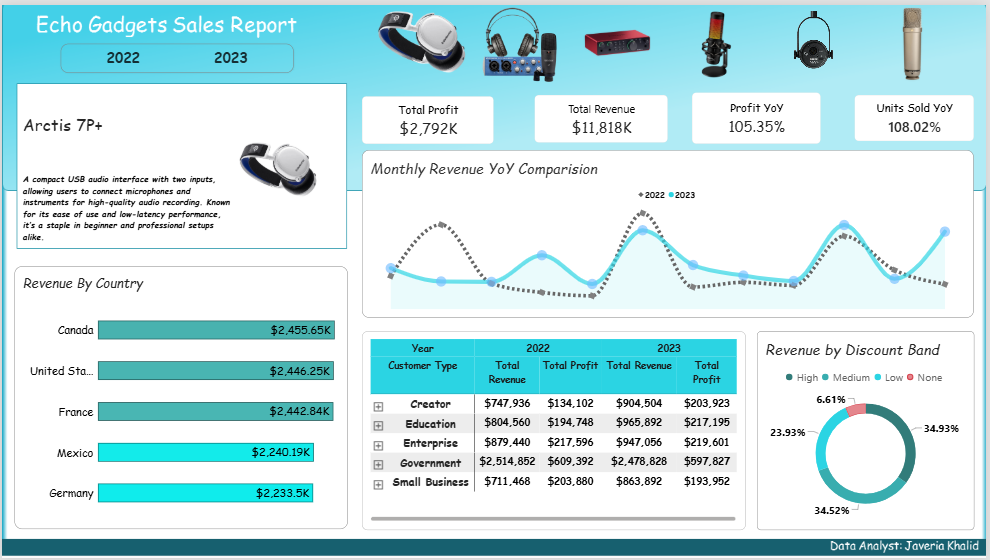

# 🎧 Echo Gadgets – Interactive Sales & Product Performance Analytics Dashboard

## 📌 Executive Overview

**Echo Gadgets** is an industry innovator specializing in high-performance audio technology, including microphones, studio audio interfaces, and digital equipment[cite: 1]. As sales expanded across multiple global territories and customer tiers, management required an executive-ready business intelligence platform to unify sales monitoring, profit tracking, discount efficiency, and product-level diagnostics[cite: 1, 2].

This repository contains the complete **Power BI Product Analytics Solution**, designed to transform multi-year transactional data (2022–2023) into clear, actionable executive insights[cite: 1].

---

## 📂 Project Structure
## 🎯 Business Problem & Key Challenges

* 🧩 **Scattered Data & Reports:** Executive leaders had to reconcile isolated regional summaries to determine overall profit ($2.79M) and top-line revenue ($11.8M)[cite: 1].
* 🏷️ **Margin Compression Risks:** Over 69% of revenue was driven by High (34.93%) and Medium (34.52%) discount bands, necessitating close inspection of pricing strategies[cite: 1].
* 🔎 **Lack of On-Demand Product Diagnostics:** Product managers needed immediate visibility into unit economics (Sale Price vs. Cost Price) and segment shares without cluttering the primary executive view[cite: 1, 2].

---

## 💻 Key Features & Interactive Architecture

### 📊 Executive Dashboard View
* **Header Slicers:** Interactive multi-year filter (2022/2023) and image-based product selection bar for instant report cross-filtering[cite: 1].
* **Core KPI Cards:** High-level executive scorecards for **Total Profit ($2,792K)**, **Total Revenue ($11,818K)**, **Profit YoY Growth (+105.35%)**, and **Units Sold YoY Growth (+108.02%)**[cite: 1].
* **Geographic Breakdown:** Ranked horizontal bar chart highlighting top-performing global markets: **Canada ($2.45M)**, **United States ($2.44M)**, and **France ($2.44M)**[cite: 1].
* **Seasonality Trends:** Line chart evaluating monthly YoY sales variations between 2022 and 2023[cite: 1].
* **Customer Segment Matrix:** Structured table tracking revenue and profit across Creator, Education, Enterprise, Government, and Small Business tiers[cite: 1].
* **Discount Band Distribution:** Donut chart analyzing sales spread across High, Medium, Low, and No discount categories[cite: 1].

### 🔲 Dynamic Product Hover Tooltip
To maintain a clean executive single-page design while enabling deep-dive analytics, a dynamic hover tooltip was implemented[cite: 1, 2]:
* **Unit Economics:** Displays unit Sale Price ($229) vs. Cost Price ($174) for clear margin calculation[cite: 2].
* **Product KPIs:** Instantly reveals product-specific Units Sold (4.18K), Net Profit ($4K), and Gross Revenue ($8.7K)[cite: 2].
* **Segment Breakdown Table:** Highlights customer segment contributions, pinpointing key demand drivers (e.g., Government segment accounting for 43.06% of Arctis 7P+ sales)[cite: 2].

[Product hover tooltip](tooltip.PNG)
---

## 💡 Key Business Insights

1. 🏛️ **Government Segment Growth:** Government accounts for **$2.48M** in 2023 revenue and represents **43.06%** of specific flagship product demand[cite: 1, 2].
2. 🏷️ **Discount Elasticity:** High and Medium discount bands drive over **69%** of gross sales volume, signaling opportunities to adjust tier thresholds to improve margins[cite: 1].
3. 🌐 **Balanced Global Market:** Revenue is distributed evenly across North America and Europe, providing strong geographical stability[cite: 1].

---

## 🚀 Strategic Recommendations

* ✂️ **Optimize Discount Tiers:** Shift strong-performing products from "High" to "Medium" discount tiers to capture higher net margins without hurting sales volume[cite: 1].
* 💼 **Expand Enterprise Contracting:** Replicate the successful procurement strategy used with Government clients to target Enterprise and Education sectors[cite: 1, 2].
* 🚚 **Inventory Planning:** Align stock allocation with seasonal peak periods identified in the monthly YoY comparison chart[cite: 1].

---

## 🛠️ Tools & Technologies Used

* **Business Intelligence:** Power BI Desktop
* **Data Modeling & Calculations:** DAX (Data Analysis Expressions) & Power Query
* **Visuals & Layout:** Custom Tooltip Pages, Dynamic KPI Cards, Matrix Visuals, Slicers

---

## 👤 Author

* **Data Analyst:** Javeria Khalid[cite: 1]
